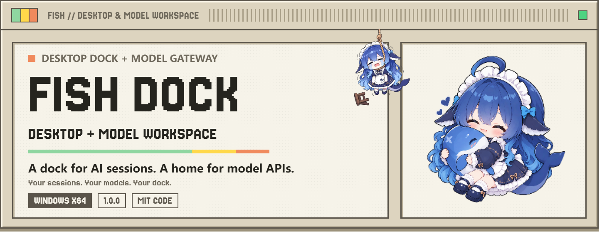
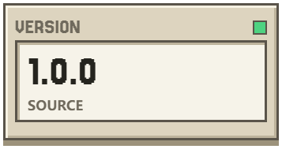
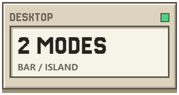
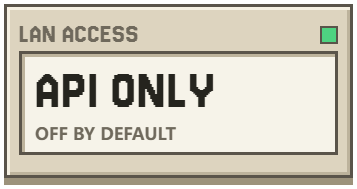
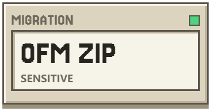

<div align="center">
<p>
<a href="README.md"><picture><source media="(prefers-color-scheme: dark)" srcset="assets/readme/key-zh-zh-dark.png"></picture></a>
<a href="README.en.md"><picture><source media="(prefers-color-scheme: dark)" srcset="assets/readme/key-en-zh-dark.png"></picture></a>
<a href="#getting-started"><picture><source media="(prefers-color-scheme: dark)" srcset="assets/readme/key-start-en-dark.png"></picture></a>
</p>
<h1><picture><source media="(prefers-color-scheme: dark)" srcset="assets/readme/hero-en-dark.png"></picture></h1>
<p>
<a href="Wakuwaku/docs/release-1.0.0.md"><picture><source media="(prefers-color-scheme: dark)" srcset="assets/readme/stat-version-en-dark.png"></picture></a>
<a href="#getting-started"><picture><source media="(prefers-color-scheme: dark)" srcset="assets/readme/stat-desktop-en-dark.png"></picture></a>
<a href="#lan-access"><picture><source media="(prefers-color-scheme: dark)" srcset="assets/readme/stat-lan-en-dark.png"></picture></a>
<a href="#configuration-and-credential-migration"><picture><source media="(prefers-color-scheme: dark)" srcset="assets/readme/stat-backup-en-dark.png"></picture></a>
</p>
<p>
<a href="https://github.com/Fish-under-sea/FISH-Dock/releases"><picture><source media="(prefers-color-scheme: dark)" srcset="assets/readme/key-download-en-dark.png"></picture></a>
<a href="Wakuwaku/docs/release-1.0.0.md"><picture><source media="(prefers-color-scheme: dark)" srcset="assets/readme/key-release-en-dark.png"></picture></a>
<a href="https://github.com/Fish-under-sea/FISH-Dock/issues"><picture><source media="(prefers-color-scheme: dark)" srcset="assets/readme/key-issues-en-dark.png"></picture></a>
</p>
</div>

FISH Dock **1.0.0** · Windows x64 · MIT-licensed code. See the [README asset credits](assets/readme/SOURCES.md).

> **A derivative integration, not an official upstream release.** FISH Dock builds on the desktop and AI-session experience of [Wakuwaku](https://github.com/zhoupengjie/Wakuwaku) and integrates the model channels and API workspace of [Our Free Model / dsh-our-free-model](https://github.com/Ebony-Vinyl/dsh-our-free-model). Both core systems remain upstream work. Original authors, copyrights, and licenses are credited below.

## One Workspace, Two Capabilities

| Desktop docking, from Wakuwaku | Model connections, from OFM |
| --- | --- |
| Taskbar, dynamic island, pets, and AI session activity | Accounts, model catalog, and OpenAI-compatible APIs |
| Agent integrations, plugins, mail, and desktop widgets | Usage, local API Key, and a separate LAN Key |
| Remembered mode, position, display, and startup entrance | An on-demand service with an owned process lifecycle |

**Local does not mean offline model inference.** The workspace, proxy, and stored data run on your computer. Model requests still go to the selected provider. Eligibility, quotas, pricing, and availability are controlled by those providers. This project does not promise unlimited usage, permanently free access, or bypasses for provider restrictions.

## New in 1.0.0

- **Trusted-LAN sharing** in OFM's API Access page: the same port number as the local service, on separate interface addresses. Off by default, with persistent settings and independent reveal, copy, and rotate controls for the LAN Key.
- **Inference only over LAN**: no management page, account-management API, or backup endpoint. Binding failures are explicit; the service does not silently choose another port or modify firewall rules.
- **OFM migration ZIP**: an explicitly confirmed download of OFM configuration, account indexes and associated credentials, existing EAC authorization, and fixed migration instructions. Not an export of the entire DSH credential store.
- **Selected upstream fixes**: proxy settings and testing, taskbar-conflict fallback, Codex trust and background hooks, Gmail authorization guidance, and inflated multimodal usage accounting for `kilo-auto/free`. No advertising and no restoration of upstream updater or crash-reporting services.
- **Continuity**: the user-provided original icon, first-launch taskbar, remembered docking mode, particle entrance, install-once runtime, and existing data directories remain.

See the [1.0.0 notes](Wakuwaku/docs/release-1.0.0.md) for sources and verification limits. Desktop proxy settings are not a universal proxy switch for OFM providers.

## Installation and Updates

Target: **Windows 10/11 x64**. System-taskbar integration mainly targets Windows 11; other Windows releases and third-party taskbar software require separate verification.

1. Download `FISH-Dock-Setup-1.0.0.exe` from [this project's Releases](https://github.com/Fish-under-sea/FISH-Dock/releases), and compare its SHA-256. An unpublished release has no download yet.
2. Fully exit the previous version from the tray. Run the installer and choose a destination. Fresh installs default to `%LOCALAPPDATA%\Programs\FISH Dock`; upgrades reuse the registered directory instead of moving it.
3. Start **FISH Dock** from the desktop or Start menu. Full Node.js, Fixed Version WebView2, the service, and license notices are bundled.
4. The first launch confirms runtime terms and verifies resources. Later launches use installed files without repeatedly extracting the entire runtime.

**The installer has no Authenticode signature.** Windows may display unknown-publisher or SmartScreen warnings. Renaming, new artwork, and self-signing cannot reliably remove reputation warnings. Use a trusted source, compare the digest, and do not disable protection, install unknown roots, or bypass organizational policy. Normal use does not generally require administrator rights.

`Error writing temporary file. Make sure your temp folder is valid.` is an NSIS bootstrap error before the install script runs. Check the temporary directory, permissions, free space, and security-software logs. If an upgrade cannot write a DLL, make sure the previous application and its children have exited; do not ignore the write failure.

## Getting Started

**Desktop:** the first launch defaults to taskbar mode. Settings and the tray switch between taskbar and island, choose the edge, and select left, center, or right island positioning. Choices survive restarts; an unavailable saved display falls back to the primary. Reduced motion uses a short fade.

**Models:** open **Local Models**, add a channel you are authorized to use, and copy the local endpoint and key from **API Access**. A typical endpoint is shown below; use the actual port displayed in the page:

```text
http://127.0.0.1:18901/v1
```

Agents, mail, and plugins still need their own clients, accounts, and permissions. Installation grants no service entitlement. Third-party authentication, downloads, and galleries keep their real destinations.

### LAN Access

1. In OFM's **API Access → LAN Access**, enable sharing only on a trusted network.
2. Copy a displayed address and the **LAN API Key**. A remote device cannot use `127.0.0.1`, and the local API Key cannot substitute for the LAN Key.
3. Configure an OpenAI-compatible client on the other device. Rotating the LAN Key invalidates the old key immediately, so update clients too.
4. Disable sharing when unnecessary. After an interface change or binding failure, turn it off and on to rebind. Only successfully bound addresses are displayed.

Management stays local. Transport uses HTTP and is intended only for trusted networks; never expose it to the public Internet. The program does not create firewall exceptions or guarantee that another computer or phone is reachable. Check firewall and network isolation yourself. Sharing a port number does not mean opening the loopback management listener on all interfaces.

### Configuration and Credential Migration

Use **Service Settings → OFM Migration Backup** and explicitly confirm the ZIP download. **The ZIP is unencrypted and must be handled like a password file.** It may contain account tokens, the local API Key, LAN Key, and EAC authorization. Never put it on GitHub, public issues, group chats, or public file shares.

Only OFM settings, account state, associated credentials, existing EAC authorization, and an integrity manifest are exported. DSH's credential vault, mail, chats, desktop layouts, browser profiles, logs, and usage statistics are excluded. Export and management are local-only.

Fully exit both applications, back up the target OFM directory, and follow the fixed `README.txt` inside the ZIP to restore relative paths. This replaces rather than merges state; there is no automatic import. Device binding, expired authorization, and firewall settings cannot be migrated by copying files. Disable the saved LAN setting before first launch on an untrusted target network. See the [fixed migration instructions](dsh-our-free-model/packages/standalone/backup-readme.txt), currently in Chinese.

## Data and Uninstallation

| Content | Location |
| --- | --- |
| Application and bundled dependencies | Chosen directory; fresh installs default to `%LOCALAPPDATA%\Programs\FISH Dock` |
| Settings, pets, layouts, and logs | `%LOCALAPPDATA%\DSH-FISH\data` |
| WebView2 profile | `%LOCALAPPDATA%\DSH-FISH\webview` |
| Runtime terms and verification state | `%LOCALAPPDATA%\DSH-FISH\state` |
| OFM accounts, keys, and usage | `%USERPROFILE%\.dsh-fish` |

`DSH-FISH.exe`, the application identifier, uninstall registration, and data directories remain for compatibility. Uninstall removes owned installation files and registration while preserving user data. Startup tasks are deleted only when verified to belong to this installation. Back up data before deleting it manually.

## Building From Source

### Gemini OAuth Client Configuration

The public source omits the upstream embedded Google OAuth client ID and secret. To use Gemini OAuth, register your own client, configure `CMDC_PAK_GOOGLE_CLIENT_ID` and `CMDC_PAK_GOOGLE_CLIENT_SECRET`, and launch the application in that environment. Without them, this channel cannot complete OAuth authorization. Never put real values in source files, commits, or issues. This change applies to the public source only; previously delivered installers were not rebuilt or replaced in this publication.

The desktop uses **Rust + Tauri 2 + HTML/CSS/JavaScript**. The model UI uses **Node.js + React**. Installers use **NSIS 3**. Building requires Windows x64, MSVC/Rust, Node.js, NSIS, and pinned official runtime downloads. Offline builds require cached dependencies; retain lock files.

```text
FISH本地模型工作台/
  Wakuwaku/              # Desktop source and this README
  dsh-our-free-model/     # Integrated service source and its licenses
```

Run `npm ci` in `dsh-our-free-model/packages/standalone`, then `node scripts/build-standalone-ui.mjs` in the service root. From the desktop directory:

```powershell
node scripts/prepare-installer.mjs --downloads <runtime-cache> --source ../dsh-our-free-model --out <new-resource-directory> --version 1.0.0
cargo test --locked --offline --features installed --manifest-path src-tauri/Cargo.toml -- --test-threads=1
node --test "test/*.test.js" "scripts/*.test.mjs"
./scripts/build-installer.ps1 -Resources <prepared-directory> -Cargo <cargo.exe> -Node <node.exe> -Makensis <makensis.exe>
```

Pinned versions and digests are in [runtime-sources.json](Wakuwaku/scripts/runtime-sources.json). Actual tests, environment limits, and historical artifacts are in the [build record](Wakuwaku/docs/installer-build.md). The installer includes neither model weights nor the development toolchain.

## Sources and Credits

| Project | Original author / maintainers | Retained contribution | License |
| --- | --- | --- | --- |
| [Wakuwaku](https://github.com/zhoupengjie/Wakuwaku) | Pengjie Zhou / zhoupengjie | Taskbar, island, pets, sessions, and desktop functions | [MIT](Wakuwaku/LICENSE), Copyright 2026 Pengjie Zhou |
| [dsh-our-free-model](https://github.com/Ebony-Vinyl/dsh-our-free-model) | Ebony-Vinyl and contributors | Model channels, accounts, usage, and compatible APIs | MIT, Copyright 2026 Ebony-Vinyl; its LICENSE and third-party notices remain bundled |

**Fish-under-sea** maintains the FISH Dock integration. New integration code uses MIT, and upstream copyright notices remain intact. Do not describe the whole feature set as original FISH Dock work or make upstream maintainers responsible for this distribution.

The application uses the user's original blue-haired character icon, not redrawn artwork or a claimed original MIT asset. Pet sprites, application artwork, and galleries do not automatically inherit the source-code license; verify their rights before redistribution. The default Claude character is designed by **ZipZipPipe**, with pixel adaptation by **zhoupengjie**. Node.js, WebView2, fflate, and other dependencies retain their own licenses.

## Feedback and Security

Report Windows and application versions, docking mode, reproduction steps, and redacted logs through [FISH Dock Issues](https://github.com/Fish-under-sea/FISH-Dock/issues). Never upload usable keys, full Cookies, private mail, or backup ZIPs, including in vulnerability reports. Preparing this repository does not create a Release; local builds do not publish or push anything automatically.
