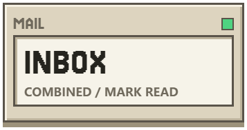

<div align="center">
<p>
<a href="README.md"><picture><source media="(prefers-color-scheme: dark)" srcset="assets/readme/key-zh-zh-dark.png"></picture></a>
<a href="README.en.md"><picture><source media="(prefers-color-scheme: dark)" srcset="assets/readme/key-en-zh-dark.png"></picture></a>
<a href="#install"><picture><source media="(prefers-color-scheme: dark)" srcset="assets/readme/key-start-en-dark.png"></picture></a>
</p>
<h1><picture><source media="(prefers-color-scheme: dark)" srcset="assets/readme/hero-en-dark.png"></picture></h1>
<p>
<a href="Wakuwaku/docs/release-2.0.0.md"><picture><source media="(prefers-color-scheme: dark)" srcset="assets/readme/stat-version-zh-dark.png"></picture></a>
<a href="#install"><picture><source media="(prefers-color-scheme: dark)" srcset="assets/readme/stat-desktop-en-dark.png"></picture></a>
<a href="#data-and-development"><picture><source media="(prefers-color-scheme: dark)" srcset="assets/readme/stat-mail-en-dark.png"></picture></a>
<a href="https://github.com/Fish-under-sea/FISH-DOCK-Plugins"><picture><source media="(prefers-color-scheme: dark)" srcset="assets/readme/stat-channels-zh-dark.png"></picture></a>
</p>
<p>
<a href="https://github.com/Fish-under-sea/FISH-Dock/releases/tag/v2.0.0"><picture><source media="(prefers-color-scheme: dark)" srcset="assets/readme/key-download-en-dark.png"></picture></a>
<a href="Wakuwaku/docs/release-2.0.0.md"><picture><source media="(prefers-color-scheme: dark)" srcset="assets/readme/key-release-en-dark.png"></picture></a>
<a href="https://github.com/Fish-under-sea/FISH-Dock/issues"><picture><source media="(prefers-color-scheme: dark)" srcset="assets/readme/key-issues-en-dark.png"></picture></a>
</p>
</div>

**2.0.0 · Windows 10/11 x64** — a desktop workspace for Agent sessions, notifications, mail and independent plugins.

[Download](https://github.com/Fish-under-sea/FISH-Dock/releases/tag/v2.0.0) · [中文](README.md) · [Official plugins](https://github.com/Fish-under-sea/FISH-DOCK-Plugins) · [Release notes](Wakuwaku/docs/release-2.0.0.md)

**2.0.0** finishes the legacy-name work. Every version position — `tauri.conf.json`, `Cargo.toml`, the Claude Code plugin manifest, the installer and these documents — is now `2.0.0`, and the old executable is no longer kept as a rollback copy. Legacy names split three ways: internal identities (the uninstall entry, the executable name, the Run value and command-line switches) are untouched; user-facing names (the Task Scheduler author and description, the user data directory) become `FISH Dock`; old uninstall entries and run values pointing at the old executable are removed on install once they are proven ours. The user data directory migrates to `%LOCALAPPDATA%\FISH Dock` and the old one is deleted right after the copy verifies; if the migration does not finish, the old directory stays exactly as it was. Both the full installer and the compact update package are published, with checksums, at [v2.0.0](https://github.com/Fish-under-sea/FISH-Dock/releases/tag/v2.0.0).

## Install

Choose the package for the published version and verify it with `SHA256SUMS.txt` from that same release.

| Package | When to use it |
| --- | --- |
| `FISH-Dock-Setup-2.0.0.exe` | First installation, missing runtimes or repair; includes the complete offline runtime. |
| `FISH-Dock-Update-2.0.0.exe` | An existing installation with intact base resources; contains changed files and prompts for the full installer if required resources are missing or damaged. |

 Exit the previous version from the tray before upgrading. The installer bundles Node.js 24.14.0, Fixed Version WebView2 155.0.4283.62, and Windhawk 1.7.3 with its LLVM-MinGW compiler. A separate Windhawk installation is unnecessary. The installer is currently unsigned.

Installed releases support manual checks in About and Updates, plus checks after launch and daily. If the GitHub API is unavailable, checks fall back to reading the official release page's version information (still surfaced in-app). Upgrade with a package installer in-app rather than replacing the host executable; the flow never opens an external web page. Same-version revisions do not trigger a version-number notification; download the revised package and verify the latest checksum.

## Changes

- GitHub device-flow refresh credentials are encrypted and renewed automatically. Temporary network errors keep the saved session; Star revalidation is distinct from signing out. Legacy sessions without saved refresh credentials require one new sign-in.

- Installer transactions remove only verified obsolete owned files. Unchanged installed resources reuse verification records; changed files and cross-volume copies are checked.
- Whole-configuration backup includes host settings, layouts, extension registration and persistent namespace configuration and secrets. Preview, before-copies and rollback protect restores.
- Device-code prompts are smaller, scroll internally and no longer use heavy shadows or a full-window dim backdrop. Temporary sign-in pinning can be released manually; the island position is restored.

- OFM, Feishu, Clash and Magpie are independent plugins. Use Settings → Plugins to sign in to GitHub and verify your star on the main FISH Dock repository. Official installation actions and feature pages become available after both checks. Installed plugins are enabled automatically; service credentials still require configuration. The desktop installer does not preinstall business plugins.
- Plugin manifests, resources, platform and storage identity are validated. A failed update rolls back to the previously installed version and data during the transaction; no old version is kept afterwards.
- OFM and Magpie retain their native management UI in a larger embedded window. Magpie's management server, model gateway and embedding proxy use separate loopback ports.
- Feishu and Clash offer one- and two-column layouts. Tabs support ordering, horizontal scrolling and mouse dragging.
- Windhawk lives in Appearance, with source or collection import, compilation, switches, backups and rollback.
- Opening a plugin no longer forces persistent pinning or always-on-top. GitHub sign-in uses an expiring temporary focus state, copies the device code before opening your browser, and polls for completion. Closing or cancelling restores manual preferences.
- Application confirmations stay inside Dock. Fullscreen exit restores visibility; explicit wake-up and approval prompts also work while another application is fullscreen.
- About and plugin cards provide update checks. Store access has a GitHub API fallback and validated offline cache. Package sizes automatically use KB, MB or GB.
- Settings restore the last tab and retain saved mode, position and display choices.
- Settings are reorganised into five pages (General / Agent / Appearance / Mail / Plugins) with a fixed section order; the regression test reads the spec file and compares.
- Plugin cards use one three-state autostart bubble: on = red "Turn off autostart", off = blue "Start with the dock", no-autostart capability = green "No autostart needed" (display only).
- About shows the brand image first and centred, clickable to the official site (override `url.official_site`); release notes show only the latest version's highlights with the full notes collapsed; sources are GitHub → Gitee → local cache (Gitee is skipped explicitly when unconfigured); built-in update finishes entirely in-app.
- Configuration lives in one place, `Wakuwaku/src-tauri/src/config.rs` (49 keys / 9 categories), every key overridable via `FISH_DOCK_*`; legacy `WAKUWAKU_*` is still read. Two self-check scripts, `scripts/check-hardcoded.mjs` and `scripts/check-contrast.mjs`, are wired into the test run.
- Theme text is white on dark and black on light; the contrast audit reports zero violations.
- Official plugins download npm `@fish-under-sea/fish-dock-plugin-*` → npmmirror → GitHub release; third-party plugins must use a `fish-dock-plugin-*` package name, search falls back to an exact name and reports how many were filtered out. Install/update are journaled transactions (interrupted installs resume, unverifiable ones roll back) and only the current version is kept.
- Gallery and downloads use one egress (respecting proxy settings, falling back to direct); timeouts are tiered and configurable; the gallery has an offline LRU cache. Mail reconnects use exponential backoff, a circuit breaker and persisted state.
- Memory: hidden means resting (a hidden page gets `IsVisible=false` and a Low memory target); `check_quiet` no longer lifts hidden pages back to normal; a parked plugin iframe retires after five minutes. The budget table has A/B/C tiers in `红线-禁止屎山十条.md` (open items tracked in issues #29 / #30).
- Naming: crate, artifacts, identifiers, CLI flags and placeholders are all FISH Dock; legacy names stay read-only, and install/update remove old executables and old scheduled-task entries.

## Data and development

The complete data root is resolved from `--data-root`, then `FISH_DOCK_HOME`, then `.fish-dock` under the current user profile. The host uses `host`; official plugins use separate `.fishplugin-*` namespaces. Disabling or uninstalling a plugin preserves its data. Use **General → FISH Dock configuration and backups** for a whole-configuration archive; the default export folder is `host/exports`. Caches, temporary files, downloadable program packages and old backups are excluded. Exported ZIPs contain plaintext secrets.

The desktop host, SDK, installer and Windhawk integration belong in this repository. Plugin business code and distribution belong in [FISH-DOCK-Plugins](https://github.com/Fish-under-sea/FISH-DOCK-Plugins). Service startup is on demand. Model requests still use the selected upstream provider and its own accounts and quotas. All directories, ports, URLs, timeouts and intervals live in one entry point, `Wakuwaku/src-tauri/src/config.rs` (49 keys / 9 categories, `FISH_DOCK_*` overridable, legacy `WAKUWAKU_*` readable); `scripts/check-hardcoded.mjs` and `scripts/check-contrast.mjs` are part of the test run.

```powershell
cargo run --locked --no-default-features --manifest-path Wakuwaku/src-tauri/Cargo.toml
node --test --test-isolation=none 'sdk/node/*.test.mjs' 'Wakuwaku/test/*.test.js'
cargo test --locked --no-default-features --manifest-path Wakuwaku/src-tauri/Cargo.toml -- --test-threads=1
```

Build inputs are pinned in `Wakuwaku/scripts/runtime-sources.json`. Prepare a new resource directory with `prepare-installer.mjs`, then build with `build-installer.ps1` and NSIS. See the Chinese README for detailed storage and build instructions.

FISH Dock derives from Wakuwaku; the historical model integration derives from Our Free Model. Original licenses and attribution remain included. Third-party runtime licenses ship with the installed resources; see [asset credits](assets/readme/SOURCES.md).
