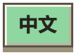
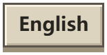
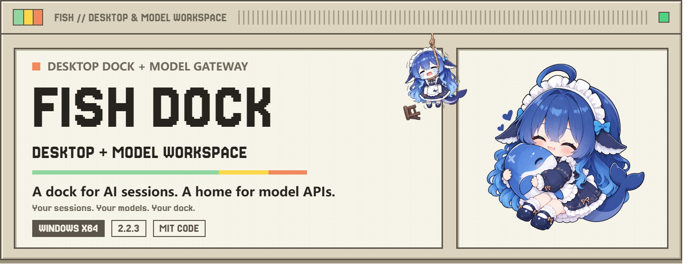
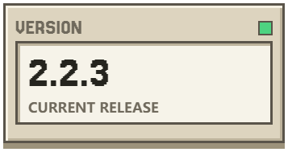
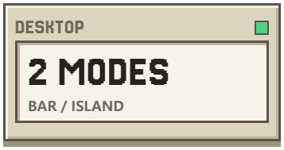
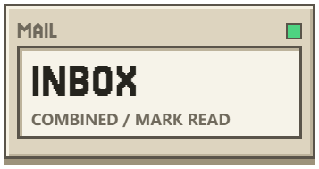
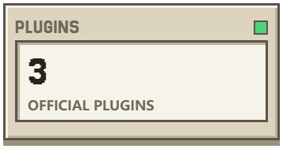
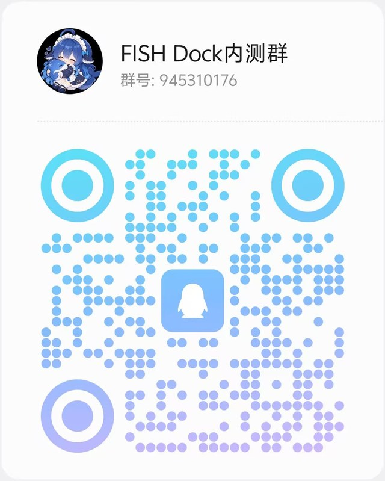

<div align="center">
<p>
<a href="README.md"><picture><source media="(prefers-color-scheme: dark)" srcset="assets/readme/key-zh-zh-dark-v223.png"></picture></a>
<a href="README.en.md"><picture><source media="(prefers-color-scheme: dark)" srcset="assets/readme/key-en-zh-dark-v223.png"></picture></a>
<a href="#install"><picture><source media="(prefers-color-scheme: dark)" srcset="assets/readme/key-start-en-dark-v223.png"></picture></a>
</p>
<h1><picture><source media="(prefers-color-scheme: dark)" srcset="assets/readme/hero-en-dark-v223.png"></picture></h1>
<p>
<a href="https://github.com/Fish-under-sea/FISH-Dock/releases/tag/v2.2.3"><picture><source media="(prefers-color-scheme: dark)" srcset="assets/readme/stat-version-en-dark-v223.png"></picture></a>
<a href="#install"><picture><source media="(prefers-color-scheme: dark)" srcset="assets/readme/stat-desktop-en-dark-v223.png"></picture></a>
<a href="#workspace"><picture><source media="(prefers-color-scheme: dark)" srcset="assets/readme/stat-mail-en-dark-v223.png"></picture></a>
<a href="https://github.com/Fish-under-sea/FISH-DOCK-Plugins"><picture><source media="(prefers-color-scheme: dark)" srcset="assets/readme/stat-channels-en-dark-v223.png"></picture></a>
</p>
<p>
<a href="https://github.com/Fish-under-sea/FISH-Dock/releases/tag/v2.2.3"><picture><source media="(prefers-color-scheme: dark)" srcset="assets/readme/key-download-en-dark-v223.png"></picture></a>
<a href="docs/releases/release-2.2.3.md"><picture><source media="(prefers-color-scheme: dark)" srcset="assets/readme/key-release-en-dark-v223.png"></picture></a>
<a href="https://github.com/Fish-under-sea/FISH-Dock/issues"><picture><source media="(prefers-color-scheme: dark)" srcset="assets/readme/key-issues-en-dark-v223.png"></picture></a>
</p>
</div>

<table>
<tr>
<td>
<p><strong>2.2.3 · Windows 10/11 x64</strong> — a desktop workspace for Agent sessions, notifications, mail and independent plugins.</p>
<p><a href="https://github.com/Fish-under-sea/FISH-Dock/releases/tag/v2.2.3">Download</a> · <a href="README.md">中文</a> · <a href="https://github.com/Fish-under-sea/FISH-DOCK-Plugins">Official plugins</a> · <a href="docs/releases/release-2.2.3.md">Release notes</a></p>
</td>
<td width="232" align="center" valign="middle">
<picture>
<source media="(prefers-color-scheme: dark)" srcset="assets/readme/join-qq-dark.jpg">

</picture>
<p><sub>Scan to join the beta group · QQ 945310176</sub></p>
</td>
</tr>
</table>

## Features

What the host itself provides. Business content — mail, models, notifications, proxy — arrives as plugins; where to find it and what you can do there is the next section.

| Capability | What it does |
| --- | --- |
| Settings | Five fixed pages (General / Agent / Appearance / Mail / Plugins) in a fixed section order; the regression test reads the spec file and compares. |
| Plugin install and update | Source, platform and resource digests are validated; official plugins resolve npm `@fish-under-sea/fish-dock-plugin-*` → npmmirror → GitHub release; install/update are journaled transactions (interrupted installs resume, unverifiable ones roll back) and only the current version is kept. One three-state autostart button per card: on "Turn off autostart", off "Start with the Dock", no-autostart capability "No autostart needed" (display only). The only solid button on a card is Update; uninstall and "Open plugin logs" move into More. |
| About and notes | Brand image first and centred, clickable to the official site (override `url.official_site`); notes show only the latest version's highlights with the full text collapsed; sources are GitHub → Gitee → local cache (Gitee is skipped explicitly when unconfigured); updates finish entirely in-app. |
| Global shortcuts | A recorder in Settings; an occupied combination is reported, and after 30 seconds without a usable one the recorder gives up instead of hanging. |
| Appearance toolchain | Connects to your own Windhawk install (2.1.2 stopped bundling the engine and compiler): import mods, compile, switch and roll back on the Appearance page. |
| Theme and legibility | White on dark, black on light; the contrast audit (`app/scripts/check-contrast.mjs`) reports zero violations. |
| Network and cache | Gallery and downloads use one egress (respecting proxy settings, falling back to direct); timeouts are tiered and configurable; the gallery has an offline LRU cache. Mail reconnects use exponential backoff, a circuit breaker and persisted state. |
| Memory | Hidden means resting (a hidden page gets `IsVisible=false` and a Low memory target); `check_quiet` no longer lifts hidden pages back to normal; a parked plugin iframe retires after five minutes. The budget table has A/B/C tiers in `红线-禁止屎山十条.md` (open items tracked in issues #29 / #30). |

## Workspace

This section is only about entry points and operations; capability detail is above.

| Page | Where to find it | What you can do |
| --- | --- | --- |
| Island | Taskbar home or floating island home; the context menu switches docking mode | Read session and approval state, open a recent task, drag it to another spot, collapse back to the tray |
| Mail | The Mail page in the workspace | Combined inbox, filters, quick actions, one- and two-column layouts |
| Model workspace | A page that appears once a model plugin is installed | Configure provider accounts, model catalog and APIs inside that plugin's own UI |
| Plugin center | Settings → Plugins | After GitHub sign-in and the Star check: install, enable, disable, uninstall, and flip the three-state autostart switch |

## Changelog

Business code, plugin packages and the store catalog are maintained in [FISH-DOCK-Plugins](https://github.com/Fish-under-sea/FISH-DOCK-Plugins); this repository owns the desktop host, SDK, installer, plugin management and Windhawk.

- **2.2.1**: no longer crashes at launch while WebView2 is being updated, and clears a stale runtime folder variable left by older versions; plugin version changes no longer fail after a plugin cleans `tmp`; closing plugin windows from the tray notifies once. Setup only. [Full notes](docs/releases/release-2.2.1.md).
- **2.2.0**: plugins explicitly request native windows outside Dock and provide their own UI. No request means no second window. Removes the hardcoded staging UI and persistent dot; in-app upgrades use Setup. **This is the final release with both Setup and Update; later releases provide Setup only.** [Full notes](docs/releases/release-2.2.0.md).
- **2.1.9**: uses system Evergreen WebView2 and transactionally removes old bundled runtime files while preserving user data. [Full notes](docs/releases/release-2.1.9.md).
- **2.1.8**: restores the system proxy when Clash exits and adds host proxy recovery. [Full notes](docs/releases/release-2.1.8.md).

See [Releases](https://github.com/Fish-under-sea/FISH-Dock/releases) for earlier versions and complete changes.

## Install

**2.2.3 provides Setup only; 2.2.0 was the final release that also shipped an Update package.** Download from the [v2.2.1 release](https://github.com/Fish-under-sea/FISH-Dock/releases/tag/v2.2.3) and verify it with `SHA256SUMS.txt` from that same release.

| Package | When to use it |
| --- | --- |
| `FISH-Dock-Setup-2.2.3.exe` | First installation, repair, the in-app update from 2.2.0, and upgrades over older versions; includes Node.js. **Requires the system Evergreen WebView2 Runtime.** If missing, Setup offers the official download page and exits without installing dependencies. |

 Exit the previous version from the tray before upgrading. The installer bundles Node.js 24.14.0 but no longer bundles Fixed Version WebView2 or its license as of 2.1.9. It uses the system Evergreen runtime. Upgrades remove installer-owned old runtime files and preserve `%LOCALAPPDATA%/FISH Dock/webview`. Update does not check system dependencies; ensure Evergreen is available before upgrading. If Update fails, use the same-version Setup manually; the installer no longer downloads a different package. Since 2.1.2 it no longer bundles the Windhawk engine or its LLVM-MinGW compiler (originally 557.8 MB / 8413 files); 2.1.6 removes the leftover Windhawk section from the Appearance page. The installer is currently unsigned.

Installed releases support manual checks in About and Updates, plus checks after launch and daily. If the GitHub API is unavailable, checks fall back to reading the official release page's version information (still surfaced in-app). From host 2.2.0 onward, in-app updates download and verify Setup; only Setup may offer an external official download page when WebView2 is missing. Same-version revisions do not trigger a version-number notification; download the revised package and verify the latest checksum.

Older hosts that have not passed through 2.2.0 should download Setup manually for a later Setup-only release.

## Data

The complete data root is resolved from `--data-root`, then `FISH_DOCK_HOME`, then `.fish-dock` under the current user profile. The host uses `host`; official plugins use separate `.fishplugin-*` namespaces. Disabling or uninstalling a plugin preserves its data. Use **General → FISH Dock configuration and backups** for a whole-configuration archive; the default export folder is `host/exports`. Caches, temporary files, downloadable program packages and old backups are excluded. Exported ZIPs contain plaintext secrets.

## Development

The desktop host, SDK, installer and Windhawk integration belong in this repository. Plugin business code and distribution belong in [FISH-DOCK-Plugins](https://github.com/Fish-under-sea/FISH-DOCK-Plugins). Service startup is on demand. Model requests still use the selected upstream provider and its own accounts and quotas. All directories, ports, URLs, timeouts and intervals live in one entry point, `app/src-tauri/src/config.rs` (49 keys / 9 categories, `FISH_DOCK_*` overridable, legacy `WAKUWAKU_*` readable); `app/scripts/check-hardcoded.mjs` and `app/scripts/check-contrast.mjs` are part of the test run.

```powershell
cargo run --locked --no-default-features --manifest-path app/src-tauri/Cargo.toml
node --test --test-isolation=none 'sdk/node/*.test.mjs' 'app/test/*.test.js' 'app/test/*.test.mjs' 'app/scripts/*.test.mjs'
cargo test --locked --no-default-features --manifest-path app/src-tauri/Cargo.toml -- --test-threads=1
```

Plugin code, packaging and the catalog live in the [official plugin repository](https://github.com/Fish-under-sea/FISH-DOCK-Plugins). Start with the [developer guide](https://github.com/Fish-under-sea/FISH-DOCK-Plugins/blob/main/docs/developers/README.md). For native windows outside Dock, see the [Hook guide](https://github.com/Fish-under-sea/FISH-DOCK-Plugins/blob/main/docs/developers/native-window-hook.md), [host API notes](docs/guides/plugin-windows-2.2.0.md) and [complete protocol example](sdk/examples/window-file-drop/README.md).

Build inputs are pinned in `app/scripts/runtime-sources.json`. Prepare a new resource directory with `prepare-installer.mjs`, then build with `build-installer.ps1` and NSIS. See the Chinese README for detailed storage and build instructions.

## Contributors

**How to contribute**: file issues and pull requests for the desktop host, SDK, installer and Windhawk integration in this repository's [GitHub Issues](https://github.com/Fish-under-sea/FISH-Dock/issues); changes to plugins, plugin packages and the store catalog go to [FISH-DOCK-Plugins](https://github.com/Fish-under-sea/FISH-DOCK-Plugins) — plugin work belongs in the plugin repository, not here.

**Contributors**: the desktop host is based on [Wakuwaku](https://github.com/zhoupengjie/Wakuwaku) by **Pengjie Zhou (zhoupengjie)**; plugins, plugin packages and the store catalog are maintained by the **contributors of [FISH-DOCK-Plugins](https://github.com/Fish-under-sea/FISH-DOCK-Plugins)**; FISH Dock is maintained by **Fish-under-sea**.

## Acknowledgements

Upstream copyright and the [MIT license](LICENSE) are retained (Wakuwaku, Copyright 2026 Pengjie Zhou); model capabilities are provided by the Magpie plugin. The Node.js license ships with the installed resources; WebView2 is provided by the system Evergreen runtime, and its Fixed Version runtime and license are no longer bundled as of 2.1.9; Windhawk is no longer redistributed as of 2.1.2, so its GPLv3 obligations follow the copy you install yourself. Source and redistribution bounds of the original brand assets are in [asset credits](assets/readme/SOURCES.md): pet sprites and the application icon keep their own asset rights and are not relicensed by the open-source code. People and repository ownership are listed under Contributors above.

Maintenance: [documentation index](docs/README.md) · [repository tools](tools/README.md) · [Agent instructions](AGENTS.md).
