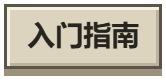
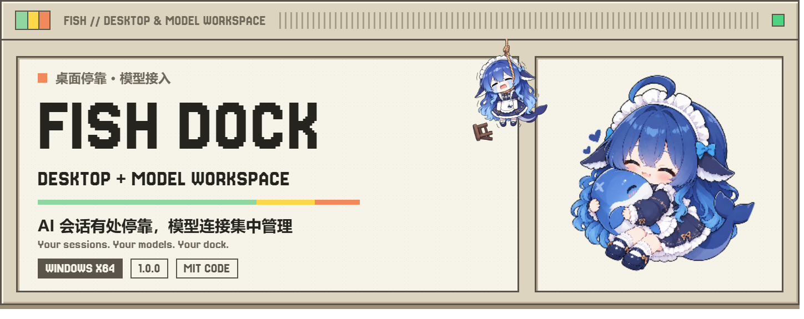
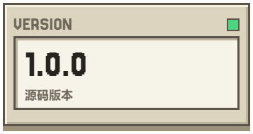
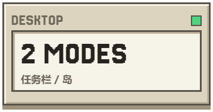
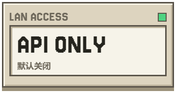
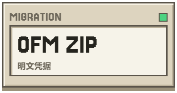
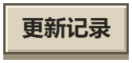

<div align="center">
<p>
<a href="README.md"><picture><source media="(prefers-color-scheme: dark)" srcset="assets/readme/key-zh-zh-dark.png"></picture></a>
<a href="README.en.md"><picture><source media="(prefers-color-scheme: dark)" srcset="assets/readme/key-en-zh-dark.png"></picture></a>
<a href="#开始使用"><picture><source media="(prefers-color-scheme: dark)" srcset="assets/readme/key-start-zh-dark.png"></picture></a>
</p>
<h1><picture><source media="(prefers-color-scheme: dark)" srcset="assets/readme/hero-zh-dark.png"></picture></h1>
<p>
<a href="Wakuwaku/docs/release-1.0.0.md"><picture><source media="(prefers-color-scheme: dark)" srcset="assets/readme/stat-version-zh-dark.png"></picture></a>
<a href="#开始使用"><picture><source media="(prefers-color-scheme: dark)" srcset="assets/readme/stat-desktop-zh-dark.png"></picture></a>
<a href="#局域网访问"><picture><source media="(prefers-color-scheme: dark)" srcset="assets/readme/stat-lan-zh-dark.png"></picture></a>
<a href="#配置与凭据迁移"><picture><source media="(prefers-color-scheme: dark)" srcset="assets/readme/stat-backup-zh-dark.png"></picture></a>
</p>
<p>
<a href="https://github.com/Fish-under-sea/FISH-Dock/releases"><picture><source media="(prefers-color-scheme: dark)" srcset="assets/readme/key-download-zh-dark.png"></picture></a>
<a href="Wakuwaku/docs/release-1.0.0.md"><picture><source media="(prefers-color-scheme: dark)" srcset="assets/readme/key-release-zh-dark.png"></picture></a>
<a href="https://github.com/Fish-under-sea/FISH-Dock/issues"><picture><source media="(prefers-color-scheme: dark)" srcset="assets/readme/key-issues-zh-dark.png"></picture></a>
</p>
</div>

FISH Dock **1.0.0** · Windows x64 · MIT 代码许可。README 排版与素材来源见 [说明](assets/readme/SOURCES.md)。

> **这是二次开发集成，不是上游官方发行版。** FISH Dock 基于 [Wakuwaku](https://github.com/zhoupengjie/Wakuwaku) 的桌面与 AI 会话体验，集成 [Our Free Model / dsh-our-free-model](https://github.com/Ebony-Vinyl/dsh-our-free-model) 的模型渠道与 API 工作台。桌面核心与模型服务核心来自上游，原作者、版权和许可证见「来源与致谢」。

## 一个工作台，两组能力

| 桌面停靠，来自 Wakuwaku | 模型接入，来自 OFM |
| --- | --- |
| 任务栏、灵动岛、宠物与 AI 会话状态 | 账号渠道、模型清单与 OpenAI 兼容 API |
| Agent 接入、插件、邮件与桌面组件 | 调用用量、本机 API Key 与独立 LAN Key |
| 保存模式、位置与屏幕，每次启动播放入场 | 按需启动独立服务，退出时回收自己的进程 |

**「本地」不等于本机离线推理。** 工作台、代理和数据在本机运行；模型请求仍发送到所选渠道的服务商。资格、额度、计费和可用性由服务商决定。本项目不承诺永久免费、无限额度或绕过服务限制。

## 1.0.0 更新

- **可信局域网共享**：在 OFM 的「API 接入」中启用 LAN，与本机服务使用相同端口号、不同监听地址；默认关闭，设置持久保存。LAN Key 独立查看、复制和轮换。
- **仅共享推理**：LAN 不提供管理页面、账号管理或备份接口。绑定失败会明确报错，不暗中换端口，不自动修改防火墙。
- **OFM 迁移 ZIP**：在「服务设置」中确认后下载 OFM 配置、账号索引及关联凭据、现有 EAC 授权和固定迁移说明，不导出整个 DSH 凭据库。
- **选择性跟进上游**：网络代理设置与测试、任务栏冲突回退、Codex 信任及后台 hooks、Gmail 授权提示，以及 `kilo-auto/free` 异常多模态 Token 计量修正。不引入广告，不恢复上游更新下载或崩溃上传。
- **保持原有习惯**：保留用户提供的原图标、首次任务栏与后续模式恢复、粒子入场、独立安装和旧数据目录。

详细来源、适用范围和测试边界见 [1.0.0 更新记录](Wakuwaku/docs/release-1.0.0.md)。桌面代理设置不是 OFM 渠道通用代理开关。

## 安装与更新

适用平台：**Windows 10/11 x64**。系统任务栏集成主要面向 Windows 11；其他系统版本与第三方任务栏软件组合需要单独验证。

1. 从 [本项目 Releases](https://github.com/Fish-under-sea/FISH-Dock/releases) 下载 `FISH-Dock-Setup-1.0.0.exe`，核对随包提供的 SHA-256。未发布 Release 时不会凭空出现下载文件。
2. 从托盘完全退出旧版，再运行安装器并选择目录。新安装默认 `%LOCALAPPDATA%\Programs\FISH Dock`；已有安装沿用登记目录覆盖升级，不自动搬迁。
3. 通过桌面或开始菜单启动 **FISH Dock**。完整 Node.js、固定版 WebView2、模型服务和许可随包安装，无需另装运行时。
4. 首次启动需要确认运行时许可并校验资源；后续使用安装目录中的文件，不重复解压整套依赖。

**安装器尚未进行 Authenticode 代码签名。** Windows 可能提示未知发布者或 SmartScreen。改名、换图标、自签名都不能可靠消除信誉提示。仅使用可信来源，核对摘要，不要关闭系统防护、导入不明根证书或绕过组织策略。通常不要求以管理员身份运行。

若出现 `Error writing temporary file. Make sure your temp folder is valid.`，这是 NSIS 执行安装脚本之前的临时目录错误，应检查临时目录、权限、磁盘空间和安全软件日志。覆盖安装出现 DLL 写入失败时，先确认旧版与其子进程已退出，不要忽略写入错误。

## 开始使用

**桌面**：首次默认任务栏；通过设置或托盘切换任务栏／灵动岛、边缘和左中右位置。退出重启保留选择，保存的显示器不可用时回退主屏。减少动态效果时使用短淡入。

**模型**：打开设置中的「本地模型」，添加有权使用的渠道，然后从「API 接入」复制本机地址与密钥。常见地址如下，实际端口以页面为准：

```text
http://127.0.0.1:18901/v1
```

Agent、邮件和第三方插件仍需要各自客户端、账号和权限；安装 FISH Dock 不会授予这些服务的使用资格。第三方登录、下载和图库链接保留真实来源。

### 局域网访问

1. 打开 OFM「API 接入 → 局域网访问」，在可信网络中启用开关。
2. 复制页面列出的当前设备地址和 **局域网 API Key**。远端客户端不能使用 `127.0.0.1`，也不能使用本机 API Key 代替 LAN Key。
3. 在另一设备配置 OpenAI 兼容客户端。轮换 LAN Key 后旧 Key 立即失效，需同步更新客户端。
4. 不用时关闭开关。地址不可用、端口被占用或网卡变化时，关闭后重新开启以重新绑定；只有成功绑定的地址才会显示。

管理页面仍仅允许本机访问。网络传输为 HTTP，只用于受信任的局域网；不要映射公网。程序不自动创建防火墙规则，也不承诺手机或另一台电脑一定可达，需检查网络隔离及系统规则。相同端口号不等于把本机管理监听开放到所有地址。

### 配置与凭据迁移

在 OFM「服务设置 → OFM 迁移备份」确认后导出 ZIP。**ZIP 未加密，属于密码文件**，可能含账号 Token、本机 API Key、LAN Key 和 EAC 授权。不要提交到 GitHub、工单、群聊或公共网盘。

备份仅含 OFM 的服务配置、账号状态、关联凭据、已有 EAC 授权及完整性清单；不含 DSH 凭据库、邮件、聊天记录、桌面布局、浏览器资料、日志或调用统计。导出与管理仅在本机提供。

迁移时先完全退出两端程序，备份目标 OFM 目录，再按 ZIP 中固定的 `README.txt` 恢复相对路径。此操作是替换而非合并，没有自动导入功能。账号设备绑定、授权过期和防火墙不会随文件迁移；目标网络不可信时，启动前先关闭备份设置中的 LAN 开关。详见 [固定迁移说明](dsh-our-free-model/packages/standalone/backup-readme.txt)。

## 数据与卸载

| 内容 | 位置 |
| --- | --- |
| 主程序和内置依赖 | 用户选择的安装目录，新安装默认 `%LOCALAPPDATA%\Programs\FISH Dock` |
| 设置、宠物、布局与日志 | `%LOCALAPPDATA%\DSH-FISH\data` |
| WebView2 用户数据 | `%LOCALAPPDATA%\DSH-FISH\webview` |
| 许可确认及资源校验状态 | `%LOCALAPPDATA%\DSH-FISH\state` |
| OFM 账号、密钥与用量 | `%USERPROFILE%\.dsh-fish` |

内部程序名 `DSH-FISH.exe`、应用标识、卸载登记和旧数据路径保留兼容，不代表显示名称未更新。卸载只移除自身安装文件与登记，保留用户数据；只清理确认属于本安装的自启动任务。手动删除数据前应先备份。

## 从源码构建

### Gemini OAuth 客户端配置

公开源码已移除上游内嵌的 Google OAuth 客户端 ID 和 Secret。使用 Gemini OAuth 前，请自行注册并配置 `CMDC_PAK_GOOGLE_CLIENT_ID` 与 `CMDC_PAK_GOOGLE_CLIENT_SECRET`，然后在相同环境中启动程序；不配置时无法完成该渠道的 OAuth 授权。不要把真实值写入源码、提交记录或工单。此变更仅针对公开源码，本次未重新构建或替换已交付安装包。

桌面使用 **Rust + Tauri 2 + HTML/CSS/JavaScript**，模型管理使用 **Node.js + React**，安装器使用 **NSIS 3**。需要 Windows x64、MSVC/Rust、Node.js、NSIS，以及锁定的官方运行时下载件。离线构建要求依赖已缓存，不能忽略锁文件。

```text
FISH本地模型工作台/
  Wakuwaku/              # 桌面源码与此 README
  dsh-our-free-model/     # 集成的服务源码与上游许可
```

先在 `dsh-our-free-model/packages/standalone` 执行 `npm ci`，再在模型服务根目录执行 `node scripts/build-standalone-ui.mjs`。然后在桌面源码目录执行：

```powershell
node scripts/prepare-installer.mjs --downloads <运行时缓存> --source ../dsh-our-free-model --out <新的资源目录> --version 1.0.0
cargo test --locked --offline --features installed --manifest-path src-tauri/Cargo.toml -- --test-threads=1
node --test "test/*.test.js" "scripts/*.test.mjs"
./scripts/build-installer.ps1 -Resources <资源目录> -Cargo <cargo.exe> -Node <node.exe> -Makensis <makensis.exe>
```

版本和官方摘要锁定在 [runtime-sources.json](Wakuwaku/scripts/runtime-sources.json)。测试证据、环境限制和历史包见 [安装版构建记录](Wakuwaku/docs/installer-build.md)。安装包不是模型权重包，也不包含开发工具链。

## 来源与致谢

| 项目 | 原作者／维护者 | 保留的核心能力 | 许可 |
| --- | --- | --- | --- |
| [Wakuwaku](https://github.com/zhoupengjie/Wakuwaku) | Pengjie Zhou / zhoupengjie | 任务栏、灵动岛、宠物、会话与桌面功能 | [MIT](Wakuwaku/LICENSE)，Copyright 2026 Pengjie Zhou |
| [dsh-our-free-model](https://github.com/Ebony-Vinyl/dsh-our-free-model) | Ebony-Vinyl 及贡献者 | 模型渠道、账号、用量与兼容 API | MIT，Copyright 2026 Ebony-Vinyl；发行包保留其 LICENSE 和第三方声明 |

**Fish-under-sea** 负责 FISH Dock 集成与维护。新增集成代码使用 MIT，上游版权声明原样保留。不能将全部功能描述为 FISH Dock 原创，也不应让上游维护者承担本发行版的支持责任。

应用沿用用户提供的蓝发角色原图标，未重新绘制，也不宣称其为原创 MIT 素材。宠物精灵图、应用图标和图库资源不自动适用源码的 MIT 许可；再分发前应核实素材授权。Claude 小姐原角色设计来自 **ZipZipPipe**，像素二创来自 **zhoupengjie**。Node.js、WebView2、fflate 及其他第三方组件保留各自许可。

## 反馈与安全

在 [FISH Dock Issues](https://github.com/Fish-under-sea/FISH-Dock/issues) 提供系统与应用版本、停靠模式、复现步骤和脱敏日志。不要上传真实密钥、完整 Cookies、私人邮件或备份 ZIP。漏洞报告也不要公开附上可用凭据。本仓库的准备不等于已创建 Release，本地构建不会自动发布或推送。
