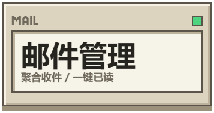
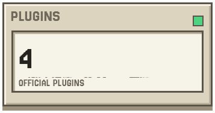
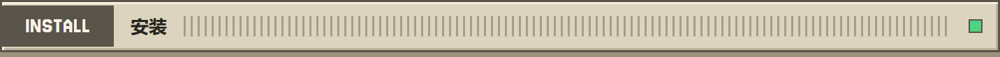

<div align="center">

<p>
  <a href="README.md"><picture><source media="(prefers-color-scheme: dark)" srcset="assets/readme/key-zh-zh-dark.png"></picture></a>
  <a href="README.en.md"><picture><source media="(prefers-color-scheme: dark)" srcset="assets/readme/key-en-zh-dark.png"></picture></a>
  <a href="#get-started"><picture><source media="(prefers-color-scheme: dark)" srcset="assets/readme/key-start-zh-dark.png"></picture></a>
</p>

<picture>
  <source media="(prefers-color-scheme: dark)" srcset="assets/readme/hero-zh-dark.png">
  
</picture>

<p>
  <a href="https://github.com/Fish-under-sea/FISH-Dock/releases/tag/v2.0.0"><picture><source media="(prefers-color-scheme: dark)" srcset="assets/readme/stat-version-zh-dark.png"></picture></a>
  <a href="#features"><picture><source media="(prefers-color-scheme: dark)" srcset="assets/readme/stat-desktop-zh-dark.png"></picture></a>
  <a href="#workspace"><picture><source media="(prefers-color-scheme: dark)" srcset="assets/readme/stat-mail-zh-dark.png"></picture></a>
  <a href="https://github.com/Fish-under-sea/FISH-DOCK-Plugins"><picture><source media="(prefers-color-scheme: dark)" srcset="assets/readme/stat-channels-zh-dark.png"></picture></a>
</p>

<p>    </p>
<p><strong>Everything is a Plugin · 一切皆插件</strong><br>一个安静的桌面宿主，把会话、模型和工具收进同一个工作台。</p>

<p>
  <a href="#get-started"><picture><source media="(prefers-color-scheme: dark)" srcset="assets/readme/key-download-zh-dark.png"></picture></a>
  <a href="Wakuwaku/docs/release-2.0.0.md"><picture><source media="(prefers-color-scheme: dark)" srcset="assets/readme/key-release-zh-dark.png"></picture></a>
  <a href="https://github.com/Fish-under-sea/FISH-Dock/issues"><picture><source media="(prefers-color-scheme: dark)" srcset="assets/readme/key-issues-zh-dark.png"></picture></a>
</p>

</div>

<h2 id="intro"><picture><source media="(prefers-color-scheme: dark)" srcset="assets/readme/section-intro-dark.png"></picture></h2>

FISH Dock 是 Windows 桌面上的会话与模型工作台。它负责窗口、桌面岛、运行时生命周期、插件页面和本地数据边界；具体业务以插件形式装载，让宿主保持清晰、可替换、可恢复。

桌面岛负责展示会话与审批状态，工作台承载邮件和插件页面。通知、代理、模型网关与模型渠道由独立插件按需提供；安装、启停和卸载都由宿主统一管理。

<h2 id="features"><picture><source media="(prefers-color-scheme: dark)" srcset="assets/readme/section-features-dark.png"></picture></h2>

| 模块 | 说明 |
| --- | --- |
| 桌面岛 | 展示会话状态、任务进度、通知和资源信息。 |
| 设置页 | 按规格重排为 5 页（通用 / Agent / 外观 / 邮件 / 插件），各页分节顺序固定；回归测试直接读规格文件比对。 |
| 模型工作台 | 承载模型插件的原生管理页，按插件配置渠道、账号与 API。 |
| 插件中心 | 校验来源、平台与资源摘要；官方插件优先 npm（`@fish-under-sea/fish-dock-plugin-*`）→ npmmirror 镜像 → GitHub Release；安装/更新为带 journal 的事务（中断可续做、不可验证则回滚），更新后只保留当前版本。插件卡上统一三态自启动按钮：已开=红「关闭自启动」、已关=蓝「随 dock 启动」、无自启动能力=绿「无需自启动」（纯展示）。 |
| 关于与公告 | 关于页品牌图首位居中、可点击进官网（地址在 `url.official_site` 可覆盖）；更新公告只显示最新版本与新特性要点，完整说明折叠；公告源 GitHub → Gitee → 本地缓存，未配置 Gitee 时明确跳过；内置更新全程在应用内完成。 |
| 外观工具链 | 随包提供 Windhawk 引擎和编译器，可在外观页导入模组、编译、启停与恢复。 |
| 主题与可读性 | 暗色白字、浅色黑字；对比度审计（`scripts/check-contrast.mjs`）违规 0。 |
| 网络与缓存 | 图库/下载走统一出口（尊重代理设置，失败回落直连）；超时分层可配；图库 LRU 缓存离线可用；邮件重连为指数退避 + 熔断 + 状态持久化。 |
| 内存 | 隐藏即休（页面隐藏则 `IsVisible=false` 并把内存目标降到 Low）；`check_quiet` 不再把隐藏页抬回 normal；插件页 iframe park 后 5 分钟整页退场。预算表按 A/B/C 三档见 `红线-禁止屎山十条.md`（含未结清项，见 issue #29 / #30）。 |
| 工作区 | 通过插件接入飞书通知、Clash 代理、Magpie 网关和 OFM 本地模型。 |

<h2 id="workspace"><picture><source media="(prefers-color-scheme: dark)" srcset="assets/readme/section-features-dark.png"></picture></h2>

| 工作区 | 作用 |
| --- | --- |
| 桌面岛 | 查看会话状态、任务进度、通知和资源信息。 |
| 邮件管理 | 聚合收件、筛选、快捷操作和单双栏布局。 |
| 模型工作台 | 在独立插件页面管理渠道账号、模型目录和 API 配置。 |
| 插件中心 | 安装官方插件、查看运行状态；安装/更新失败按事务回滚。 |

业务源码、插件包和商店目录由 [FISH-DOCK-Plugins](https://github.com/Fish-under-sea/FISH-DOCK-Plugins) 维护。本仓负责桌面宿主、SDK、安装器、插件管理与 Windhawk。

`2.0.0` 收口批：宿主把所有版本位统一为 `2.0.0`（`tauri.conf.json`、`Cargo.toml`、Claude Code 插件清单、安装器与 README），旧版 exe 不再留作回滚副本。设置页按规格重排为 5 页固定分节（回归测试读规格文件比对）；插件卡的自启动改为三态气泡按钮（红「关闭自启动」/ 蓝「随 dock 启动」/ 绿「无需自启动」）；关于页品牌图首位居中可点进官网，公告只显示最新版本与新特性要点、完整说明折叠，源为 GitHub → Gitee → 本地缓存且应用内更新。配置收敛到单一入口 `Wakuwaku/src-tauri/src/config.rs`（49 键 / 9 类，全部支持 `FISH_DOCK_*` 环境变量覆盖，旧 `WAKUWAKU_*` 仍可读），并新增 `scripts/check-hardcoded.mjs`（硬编码）与 `scripts/check-contrast.mjs`（对比度）两个自查脚本、均接入测试。

命名上 crate / 产物 / identifier / CLI 旗标 / 占位符统一为 FISH Dock 命名，旧名只读兼容；内部身份（卸载表登记名、主程序文件名、Run 值与命令行开关）一个字没动，给人看的名字（任务计划里的作者与说明、用户数据目录）换成 `FISH Dock`，旧卸载登记与指向旧 exe 的自启动值在安装时按归属清理，安装与更新会清理旧 exe 与旧任务计划项。用户数据目录迁到 `%LOCALAPPDATA%\FISH Dock` 后直接删除旧目录，没迁完就原样保留并提示。完整变化见 [2.0.0 更新记录](Wakuwaku/docs/release-2.0.0.md)。

<h2 id="get-started"><picture><source media="(prefers-color-scheme: dark)" srcset="assets/readme/section-install-dark.png"></picture></h2>

**FISH Dock 2.0.0** 提供完整安装包和精简更新包。本次改名收尾：任务计划、卸载登记与用户数据目录里的旧发行名统一为 `FISH Dock`，旧目录迁完即删；插件卡上的自启动是三态气泡按钮——已开=红「关闭自启动」、已关=蓝「随 dock 启动」、无自启动能力=绿「无需自启动」（纯展示）。下载及校验文件见 [v2.0.0 Release](https://github.com/Fish-under-sea/FISH-Dock/releases/tag/v2.0.0)。

| 安装包 | 使用场景 |
| --- | --- |
| `FISH-Dock-Setup-2.0.0.exe` | 首次安装、基础资源缺失或修复安装，包含完整离线运行时。 |
| `FISH-Dock-Update-2.0.0.exe` | 已有版本且基础资源完整时使用，只下载本次变更；缺失或损坏时提示改用完整包。 |

1. 从 [Releases](https://github.com/Fish-under-sea/FISH-Dock/releases/tag/v2.0.0) 选择已发布版本的对应安装包，并用同版本 `SHA256SUMS.txt` 核对摘要。
2. 安装后从桌面或开始菜单打开 FISH Dock，首次启动会核对运行资源并展示运行时条款。
3. 打开「插件」页，点击「GitHub 登录」。Dock 内弹窗显示验证码及实际复制结果；在系统浏览器中粘贴并确认，Dock 自动检查授权。等待期间可单独解除临时锁定／置顶，也可取消验证。旧版账号若未保存续期凭据，升级后需重新登录一次；新授权随后自动续期。
4. 为 [FISH Dock 主仓](https://github.com/Fish-under-sea/FISH-Dock) 点 Star，再点击「检查登录与 Star」。登录和 Star 均验证通过后，官方插件安装入口及对应功能页才会显示。
5. 点击「检查更新」读取官方目录，按需安装 [FISH Dock Official Plugins](https://github.com/Fish-under-sea/FISH-DOCK-Plugins)。新插件安装成功即启用；凭据和服务参数仍需各自配置。

安装包包含 Node.js 24.14.0、固定版 WebView2 155.0.4283.62、Windhawk 1.7.3 及 LLVM-MinGW 编译器，供对应插件按需调用；无需另外安装 Windhawk。安装包当前未做 Authenticode 签名。

正式安装版在「关于」和「软件更新」均可检查官方新版本，并在启动后及每天自动检查。GitHub API 受限时自动改读官方 Release 的版本信息（仍在应用内提示）；新版通过完整安装包或精简更新包在应用内升级，不单独替换宿主 EXE、不跳转外部网页。同版本修订不会因为版本号相同自动提示，请从 Release 重新下载安装并核对最新 SHA-256。

<h2 id="data"><picture><source media="(prefers-color-scheme: dark)" srcset="assets/readme/section-intro-dark.png"></picture></h2>

启动时解析完整数据根：`--data-root` → `FISH_DOCK_HOME` → 当前用户目录下 `.fish-dock`。宿主、插件和凭据都在这个根目录下按命名空间分开保存。

| 归属 | 根内目录 |
| --- | --- |
| 宿主 | `host` |
| 官方插件 | `.fishplugin-<name>` |
| 第三方插件 | `.plugin.<publisher>.<name>` |

每个命名空间继续按 `credentials`、`roster`、`keys`、`config`、`exports`、`backups`、`tmp` 分类。「通用 → FISH Dock 配置与备份」可导出宿主设置、布局、插件注册及各插件的持久配置与凭据，默认保存在 `host/exports`。导入先预览并保留恢复前副本，失败按事务回滚；缓存、临时文件、程序包及历史备份不重复打包。普通 ZIP 含明文凭据，请妥善保存。

<h2 id="development"><picture><source media="(prefers-color-scheme: dark)" srcset="assets/readme/section-develop-dark.png"></picture></h2>

需要 Rust MSVC 工具链、Windows SDK 和 Node.js 24。开发版可以通过 `FISH_DOCK_DEV_NODE`、`FISH_DOCK_DEV_PLUGINS` 指定运行时，发行版使用安装资源与插件目录。所有目录/端口/URL/超时/间隔集中在单一入口 `Wakuwaku/src-tauri/src/config.rs`（49 键 / 9 类，全部支持 `FISH_DOCK_*` 覆盖，旧 `WAKUWAKU_*` 仍可读）；硬编码与对比度自查脚本为 `Wakuwaku/scripts/check-hardcoded.mjs`、`Wakuwaku/scripts/check-contrast.mjs`，均已接入测试。

```powershell
cargo run --locked --no-default-features --manifest-path Wakuwaku/src-tauri/Cargo.toml
node --test --test-isolation=none 'sdk/node/*.test.mjs' 'Wakuwaku/test/*.test.js'
cargo test --locked --no-default-features --manifest-path Wakuwaku/src-tauri/Cargo.toml -- --test-threads=1
```

插件源码、插件包和目录维护在 [FISH-DOCK-Plugins](https://github.com/Fish-under-sea/FISH-DOCK-Plugins)。

<h2 id="source"><picture><source media="(prefers-color-scheme: dark)" srcset="assets/readme/section-intro-dark.png"></picture></h2>

FISH Dock 基于 [Wakuwaku](https://github.com/zhoupengjie/Wakuwaku) 演进，保留原作者版权与 MIT 许可；历史模型能力源自 [Our Free Model](https://github.com/Ebony-Vinyl/dsh-our-free-model)。原始品牌素材见 [素材记录](assets/readme/SOURCES.md)。Windhawk、Node.js、WebView2 和编译器的原文许可随运行资源交付。

<p align="center"><sub>FISH Dock · Desktop + Model Workspace · Windows x64</sub></p>
