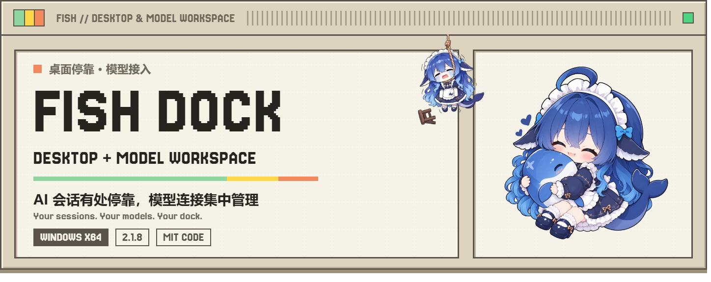
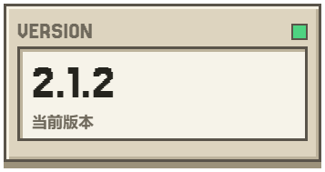
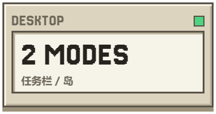
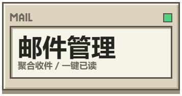
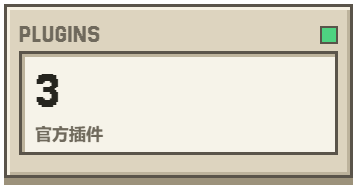

<div align="center">

<p>
  <a href="README.md"><picture><source media="(prefers-color-scheme: dark)" srcset="assets/readme/key-zh-zh-dark.png"></picture></a>
  <a href="README.en.md"><picture><source media="(prefers-color-scheme: dark)" srcset="assets/readme/key-en-zh-dark.png"></picture></a>
  <a href="#get-started"><picture><source media="(prefers-color-scheme: dark)" srcset="assets/readme/key-start-zh-dark.png"></picture></a>
</p>

<picture>
  <source media="(prefers-color-scheme: dark)" srcset="assets/readme/hero-zh-dark.png">
  
</picture>

<p>
  <a href="https://github.com/Fish-under-sea/FISH-Dock/releases/tag/v2.1.1"><picture><source media="(prefers-color-scheme: dark)" srcset="assets/readme/stat-version-zh-dark.png"></picture></a>
  <a href="#features"><picture><source media="(prefers-color-scheme: dark)" srcset="assets/readme/stat-desktop-zh-dark.png"></picture></a>
  <a href="#workspace"><picture><source media="(prefers-color-scheme: dark)" srcset="assets/readme/stat-mail-zh-dark.png"></picture></a>
  <a href="https://github.com/Fish-under-sea/FISH-DOCK-Plugins"><picture><source media="(prefers-color-scheme: dark)" srcset="assets/readme/stat-channels-zh-dark-v2.png"></picture></a>
</p>

<p>    </p>
<p><strong>Everything is a Plugin · 一切皆插件</strong><br>一个安静的桌面宿主，把会话、模型和工具收进同一个工作台。</p>

<p>
  <a href="#get-started"><picture><source media="(prefers-color-scheme: dark)" srcset="assets/readme/key-download-zh-dark.png"></picture></a>
  <a href="app/docs/release-2.1.1.md"><picture><source media="(prefers-color-scheme: dark)" srcset="assets/readme/key-release-zh-dark.png"></picture></a>
  <a href="https://github.com/Fish-under-sea/FISH-Dock/issues"><picture><source media="(prefers-color-scheme: dark)" srcset="assets/readme/key-issues-zh-dark.png"></picture></a>
</p>

</div>

<h2 id="intro"><picture><source media="(prefers-color-scheme: dark)" srcset="assets/readme/section-intro-dark-v3.png"></picture></h2>

FISH Dock 是 Windows 桌面上的会话与模型工作台。它负责窗口、桌面岛、运行时生命周期、插件页面和本地数据边界；具体业务以插件形式装载，让宿主保持清晰、可替换、可恢复。

桌面岛负责展示会话与审批状态，工作台承载邮件和插件页面。通知、代理、模型网关与模型渠道由独立插件按需提供；安装、启停和卸载都由宿主统一管理。

<h2 id="features"><picture><source media="(prefers-color-scheme: dark)" srcset="assets/readme/section-features-dark-v3.png"></picture></h2>

宿主自身提供的能力，业务侧内容（邮件、模型、通知、代理）以插件装载，入口与操作见下一节「工作区」。

| 能力 | 说明 |
| --- | --- |
| 设置页 | 按规格重排为 5 页（通用 / Agent / 外观 / 邮件 / 插件），各页分节顺序固定；回归测试直接读规格文件比对。 |
| 插件安装与更新 | 校验来源、平台与资源摘要；官方插件优先 npm（`@fish-under-sea/fish-dock-plugin-*`）→ npmmirror 镜像 → GitHub Release；安装/更新为带 journal 的事务（中断可续做、不可验证则回滚），更新后只保留当前版本。插件卡上统一三态自启动按钮：已开「关闭自启动」、已关「随 Dock 启动」、无自启动能力「无需自启动」（纯展示）；卡内唯一实心按钮是「更新」，卸载与「打开插件日志」收进「更多」。 |
| 关于与公告 | 关于页品牌图首位居中、可点击进官网（地址在 `url.official_site` 可覆盖）；更新公告只显示最新版本与新特性要点，完整说明折叠；公告源 GitHub → Gitee → 本地缓存，未配置 Gitee 时明确跳过；内置更新全程在应用内完成。 |
| 全局快捷键 | 设置页可录制组合键；被其他程序占用时给出提示，30 秒内未录到可用组合就放弃。 |
| 外观工具链 | 随包提供 Windhawk 引擎和编译器，可在外观页导入模组、编译、启停与恢复。 |
| 主题与可读性 | 暗色白字、浅色黑字；对比度审计（`scripts/check-contrast.mjs`）违规 0。 |
| 网络与缓存 | 图库/下载走统一出口（尊重代理设置，失败回落直连）；超时分层可配；图库 LRU 缓存离线可用；邮件重连为指数退避 + 熔断 + 状态持久化。 |
| 内存 | 隐藏即休（页面隐藏则 `IsVisible=false` 并把内存目标降到 Low）；`check_quiet` 不再把隐藏页抬回 normal；插件页 iframe park 后 5 分钟整页退场。预算表按 A/B/C 三档见 `红线-禁止屎山十条.md`（含未结清项，见 issue #29 / #30）。 |

<h2 id="workspace"><picture><source media="(prefers-color-scheme: dark)" srcset="assets/readme/section-workspace-dark-v3.png"></picture></h2>

这一节只讲入口与操作，能力细节见上一节。

| 页面 | 从哪进 | 能做什么 |
| --- | --- | --- |
| 桌面岛 | 任务栏家或悬浮岛家；右键菜单切换停靠方式 | 看会话与审批状态、点开最近任务、拖到别处停靠、收起回托盘 |
| 邮件 | 工作台左侧「邮件」页 | 聚合收件、筛选、快捷操作、单双栏布局切换 |
| 模型工作台 | 装好模型插件后出现的独立页 | 在插件自己的界面里配渠道账号、模型目录与 API |
| 插件中心 | 设置 → 插件页 | 登录 GitHub 并核对 Star 后安装/启用/停用/卸载，卡上拨三态自启动 |

<h2 id="changelog"><picture><source media="(prefers-color-scheme: dark)" srcset="assets/readme/section-changelog-dark-v3.png"></picture></h2>

业务源码、插件包和商店目录由 [FISH-DOCK-Plugins](https://github.com/Fish-under-sea/FISH-DOCK-Plugins) 维护。本仓负责桌面宿主、SDK、安装器、插件管理与 Windhawk。

2.1.1 补丁版：宿主 2.1.1，兼容插件 2.x（官方目录当前 2.2.0：Clash / Magpie / 飞书）。这一版办两件事：**#72 第三方插件识别排除官方三个插件**——官方三个包在 npm 上也有合规包名，第三方页的默认发现词恰好把它们排在最前，现在检索与安装口一律排除并提示「请到官方插件页安装」，不再出现「从第三方页装官方插件」；**自动检查更新的 Gitee 拉取恢复**——Gitee 侧已有发行资产，`url.gitee_repo` 默认启用主仓镜像（写 `off` 关闭），同时修掉「按便携 exe 历史名探 `.sha256` 所以 Gitee 恒 404」的错位。完整说明见 [2.1.1 更新记录](app/docs/release-2.1.1.md)。

2.1.0 功能版：宿主 2.1.0，兼容插件 2.x（官方目录当前 2.2.0：Clash / Magpie / 飞书）。这一版收了主仓四条 OPEN issue 与一条历史欠账：#68 插件下载在**三源全灭时按来源回退上一可用版本**（目录抢跑不再等于必失败，回退仍严格校验摘要）；#69 插件卡下半区压到 105px、标题 17px/600、**Dock 弹窗锁滚动**；#70 自启失败记录带阶段与耗时、手动启用补一次**锁外**退避重试；附加的国内镜像欠账落地为「配了才启用」的 Gitee 通道 + 一份**实测**来源矩阵。完整说明、安装包与已知限制见 [2.1.0 更新记录](app/docs/release-2.1.0.md)。

2.0.4 修订版：宿主 2.0.4，兼容插件 2.1.x（Clash 与 Magpie 2.1.3、飞书 2.1.0）。这一版收了 #63、#65、#66、#67 四条 issue 并回归 #64：插件自启改为单一调度器（冷 60 秒／热 10 秒一次共用预算、整轮 180 秒、每插件单在途、最多两插件并发、迟到结果按代次丢弃），修掉备份暂停时的二次拉起；资源获取统一到择源层（原站优先、镜像候选、按代理路重试、一条总预算、唯一临时文件与原子落地），更新包下载同源，pet 的资源改由宿主取回缓存；检查到新版本时 pet 会弹提醒；插件页「更多」改整行动作列表、npm 检索支持短页续翻；插件页外链经宿主受控通道打开（只认 http/https）；OFM 业务彻底解耦、旧命名清理，Agent 会话 API（`/v1`）与 `agent-core` 就位。完整说明与已知限制见 [2.0.4 更新记录](app/docs/release-2.0.4.md)。

2.0.3 补丁版：宿主 2.0.3，兼容插件 2.1.x（Clash 与 Magpie 2.1.3、飞书 2.1.0）。这一版把插件启动链路的任务书做完九项（T02 留 2.1.0）：资源校验判据改逐文件 size+mtime 指纹、全量哈希移出首启关键路径、WebView2 授权改为按需（T06/T07/T08）；插件校验加 size+mtime 快照缓存、插件页面入口不再持全局锁（T03/T09）；插件调用超时分冷/热两档（热 5 s、冷 20 s），冷态失败重试一次（T04）；维护线程与安装/卸载/启停收进同一把上层互斥，不再有「维护线程删掉正在写入的版本目录」这类竞态（t19）。插件页卡面同时重做：状态收成一条 `● 运行中 · v2.1.2 → v2.1.3`，卡内只留一颗实心「更新」，带功能页的卡从 4 行压到 3 行。完整说明与 12 条已知限制见 [2.0.3 更新记录](app/docs/release-2.0.3.md)。

2.0.2 补丁版：宿主 2.0.2，兼容插件 2.1.x。这一版只修插件的「看不见、查不到、停不掉」：插件 stderr 不再被丢弃，落盘到 `host/plugin-logs/<插件 id>.log`（单文件 1 MB、留 2 份、写入前脱敏），失败记录结构化进 `host/plugin-failures.log`（含退出码与日志路径），插件卡新增「打开插件日志」；插件未运行时标签页不再消失，点进去能看到原因并当场「启动」；运行态判据从「进程存活」改为「进程存活 + 握手可应答」，残留内核回收改按 pid + 启动时刻 + 控制器可达三重判定，不再误杀被复用的 pid。完整说明见 [2.0.2 更新记录](app/docs/release-2.0.2.md)。

2.0.1 维护版：宿主 2.0.1，兼容插件 2.1.x（Magpie 已到 2.1.1）。设置页公告区有内容时也有「刷新」，打开关于页超 5 分钟自动重取，公告标题不再重复版本号；新增全局快捷键与设置页录制节（被占用有提示、30 秒重试后放弃）；插件更新/卸载走事务（旧版目录清零、卸载彻底但保留用户数据）、自启动运行中即时生效；无标题窗口也有任务栏按钮、托盘图标点击可用、右键菜单精简；换显示器或改缩放后工作区自愈、文字 110% 下任务栏不再上浮；卡死抓栈、WebView2 被外部结束不再误报。商店里 OFM 本地模型已下架（已装用户仍可启用/卸载），模型能力由 Magpie 插件提供；agy 岛上审批与内存账转 2.1.0。完整说明见 [2.0.1 更新记录](app/docs/release-2.0.1.md)。

`2.0.0` 收口批：宿主把所有版本位统一为 `2.0.0`（`tauri.conf.json`、`Cargo.toml`、Claude Code 插件清单、安装器与 README），旧版 exe 不再留作回滚副本。设置页按规格重排为 5 页固定分节（回归测试读规格文件比对）；插件卡的自启动改为三态气泡按钮（红「关闭自启动」/ 蓝「随 Dock 启动」/ 绿「无需自启动」）；关于页品牌图首位居中可点进官网，公告只显示最新版本与新特性要点、完整说明折叠，源为 GitHub → Gitee → 本地缓存且应用内更新。配置收敛到单一入口 `app/src-tauri/src/config.rs`（49 键 / 9 类，全部支持 `FISH_DOCK_*` 环境变量覆盖，旧 `WAKUWAKU_*` 仍可读），并新增 `scripts/check-hardcoded.mjs`（硬编码）与 `scripts/check-contrast.mjs`（对比度）两个自查脚本、均接入测试。

命名上 crate / 产物 / identifier / CLI 旗标 / 占位符统一为 FISH Dock 命名，旧名只读兼容；内部身份（卸载表登记名、主程序文件名、Run 值与命令行开关）一个字没动，给人看的名字（任务计划里的作者与说明、用户数据目录）换成 `FISH Dock`，旧卸载登记与指向旧 exe 的自启动值在安装时按归属清理，安装与更新会清理旧 exe 与旧任务计划项。用户数据目录迁到 `%LOCALAPPDATA%\FISH Dock` 后直接删除旧目录，没迁完就原样保留并提示。完整变化见 [2.0.0 更新记录](app/docs/release-2.0.0.md)。

<h2 id="get-started"><picture><source media="(prefers-color-scheme: dark)" srcset="assets/readme/section-install-dark-v3.png"></picture></h2>

**FISH Dock 2.1.1** 提供完整安装包和精简更新包。本版两件事：① **第三方插件页不再把官方三个插件当成第三方**——检索与安装口一律排除官方包，并提示去「官方插件」页；② **自动检查更新恢复 Gitee 拉取**——默认带主仓 Gitee 镜像，国内不配代理也能查新版并从 Gitee 下载安装器（写 `off` 可关闭）。下载及校验文件见 [v2.1.1 Release](https://github.com/Fish-under-sea/FISH-Dock/releases/tag/v2.1.1)。

| 安装包 | 使用场景 |
| --- | --- |
| `FISH-Dock-Setup-2.1.1.exe` | 首次安装、基础资源缺失或修复安装，包含完整离线运行时（约 312 MB）。 |
| `FISH-Dock-Update-2.1.1.exe` | 已有版本且基础资源完整时使用，只含相对 **2.1.0** 的变更（约 30 MB）；缺失或损坏时提示改用完整包。 |

1. 从 [Releases](https://github.com/Fish-under-sea/FISH-Dock/releases/tag/v2.1.1) 选择已发布版本的对应安装包，并用同版本 `SHA256SUMS.txt` 核对摘要。
2. 安装后从桌面或开始菜单打开 FISH Dock，首次启动会核对运行资源并展示运行时条款。
3. 打开「插件」页，点击「GitHub 登录」。Dock 内弹窗显示验证码及实际复制结果；在系统浏览器中粘贴并确认，Dock 自动检查授权。等待期间可单独解除临时锁定／置顶，也可取消验证。旧版账号若未保存续期凭据，升级后需重新登录一次；新授权随后自动续期。
4. 为 [FISH Dock 主仓](https://github.com/Fish-under-sea/FISH-Dock) 点 Star，再点击「检查登录与 Star」。登录和 Star 均验证通过后，官方插件安装入口及对应功能页才会显示。
5. 点击「检查更新」读取官方目录，按需安装 [FISH Dock Official Plugins](https://github.com/Fish-under-sea/FISH-DOCK-Plugins)。新插件安装成功即启用；凭据和服务参数仍需各自配置。
6. 官方商店目前只有**三个插件**：**飞书**、**Clash**、**Magpie**（飞书 2.1.0，Clash 与 Magpie 2.1.3；要求宿主 ≥ 2.0.0）。OFM 自 2026-10-25 起暂停维护，已从商店下架——已安装的用户仍可在「已安装」里启用或卸载。

安装包包含 Node.js 24.14.0、固定版 WebView2 155.0.4283.62、Windhawk 1.7.3 及 LLVM-MinGW 编译器，供对应插件按需调用；无需另外安装 Windhawk。安装包当前未做 Authenticode 签名。

正式安装版在「关于」和「软件更新」均可检查官方新版本，并在启动后及每天自动检查。GitHub API 受限时自动改读官方 Release 的版本信息（仍在应用内提示）；新版通过完整安装包或精简更新包在应用内升级，不单独替换宿主 EXE、不跳转外部网页。同版本修订不会因为版本号相同自动提示，请从 Release 重新下载安装并核对最新 SHA-256。

<h2 id="data"><picture><source media="(prefers-color-scheme: dark)" srcset="assets/readme/section-data-dark-v3.png"></picture></h2>

启动时解析完整数据根：`--data-root` → `FISH_DOCK_HOME` → 当前用户目录下 `.fish-dock`。宿主、插件和凭据都在这个根目录下按命名空间分开保存。

| 归属 | 根内目录 |
| --- | --- |
| 宿主 | `host` |
| 官方插件 | `.fishplugin-<name>` |
| 第三方插件 | `.plugin.<publisher>.<name>` |

每个命名空间继续按 `credentials`、`roster`、`keys`、`config`、`exports`、`backups`、`tmp` 分类。「通用 → FISH Dock 配置与备份」可导出宿主设置、布局、插件注册及各插件的持久配置与凭据，默认保存在 `host/exports`。导入先预览并保留恢复前副本，失败按事务回滚；缓存、临时文件、程序包及历史备份不重复打包。普通 ZIP 含明文凭据，请妥善保存。

<h2 id="development"><picture><source media="(prefers-color-scheme: dark)" srcset="assets/readme/section-develop-dark-v3.png"></picture></h2>

需要 Rust MSVC 工具链、Windows SDK 和 Node.js 24。开发版可以通过 `FISH_DOCK_DEV_NODE`、`FISH_DOCK_DEV_PLUGINS` 指定运行时，发行版使用安装资源与插件目录。所有目录/端口/URL/超时/间隔集中在单一入口 `app/src-tauri/src/config.rs`（49 键 / 9 类，全部支持 `FISH_DOCK_*` 覆盖，旧 `WAKUWAKU_*` 仍可读）；硬编码与对比度自查脚本为 `app/scripts/check-hardcoded.mjs`、`app/scripts/check-contrast.mjs`，均已接入测试。

```powershell
cargo run --locked --no-default-features --manifest-path app/src-tauri/Cargo.toml
node --test --test-isolation=none 'sdk/node/*.test.mjs' 'app/test/*.test.js'
cargo test --locked --no-default-features --manifest-path app/src-tauri/Cargo.toml -- --test-threads=1
```

构建输入固定在 `app/scripts/runtime-sources.json`；资源目录由 `prepare-installer.mjs` 准备，再用 `build-installer.ps1` 与 NSIS 打包。

<h2 id="contributors"><picture><source media="(prefers-color-scheme: dark)" srcset="assets/readme/section-contributors-dark-v3.png"></picture></h2>

**如何贡献**：桌面宿主、SDK、安装器与 Windhawk 相关的问题和改动提到本仓 [GitHub Issues](https://github.com/Fish-under-sea/FISH-Dock/issues) 与 PR；插件、插件包与商店目录的改动提到 [FISH-DOCK-Plugins](https://github.com/Fish-under-sea/FISH-DOCK-Plugins)，插件相关改动提在插件仓，不要提到宿主仓。

**贡献者**：桌面宿主基于 **Pengjie Zhou（zhoupengjie）** 的 [Wakuwaku](https://github.com/zhoupengjie/Wakuwaku)；插件、插件包与商店目录由 **[FISH-DOCK-Plugins](https://github.com/Fish-under-sea/FISH-DOCK-Plugins) 的贡献者**维护；FISH Dock 由 **Fish-under-sea** 维护。

<h2 id="source"><picture><source media="(prefers-color-scheme: dark)" srcset="assets/readme/section-acknowledgements-dark-v3.png"></picture></h2>

上游代码的版权与 [MIT 许可](LICENSE) 保留（Wakuwaku，Copyright 2026 Pengjie Zhou）；模型能力由 Magpie 插件提供。Windhawk、Node.js、WebView2 与编译器的原文许可随运行资源交付。原始品牌素材的来源与授权边界见 [素材记录](assets/readme/SOURCES.md)：宠物精灵图与应用图标遵循各自素材授权，不因代码开源而自动获得再分发许可。人员与仓库归属见上一节「贡献者」。

<p align="center"><sub>FISH Dock · Desktop + Model Workspace · Windows x64</sub></p>
