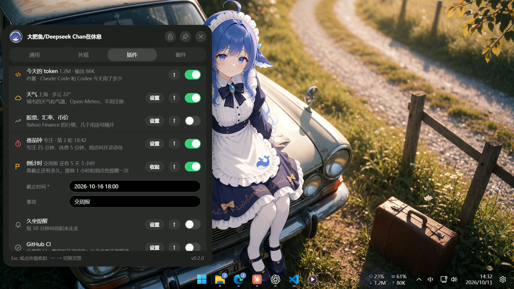

<p align="center">
  <a href="README.md"></a>
  <a href="README.en.md"></a>
  <a href="#快速开始"></a>
</p>

<picture>
  <source media="(prefers-color-scheme: dark)" srcset="assets/readme/hero-zh-dark.png">
  
</picture>

<p align="center">
  <a href="https://github.com/Fish-under-sea/FISH-Dock/releases/tag/v1.1.0"></a>
  <a href="Wakuwaku/docs/release-1.1.0.md"></a>
  <a href="https://github.com/Fish-under-sea/FISH-Dock/issues"></a>
</p>

<p align="center"><strong>Everything is a Plugin · 一切皆插件</strong><br>FISH Dock 只负责桌面承载、生命周期、数据边界和插件页面；业务能力按需安装。</p>
<p align="center"><strong>FISH Dock 1.1.0 · Windows 10/11 x64 · MIT</strong></p>
<table>
  <tr>
    <td></td>
    <td></td>
    <td></td>
    <td></td>
  </tr>
</table>

<table>
  <tr>
    <td width="28%"><strong>INDEX</strong><br><strong>目录</strong></td>
    <td><a href="#快速开始">快速开始</a> · <a href="#核心能力">核心能力</a> · <a href="#插件与数据">插件与数据</a><br><a href="#界面预览">界面预览</a> · <a href="#开发与构建">开发与构建</a> · <a href="#来源">来源</a></td>
  </tr>
</table>

## 快速开始

1. 从 [Releases](https://github.com/Fish-under-sea/FISH-Dock/releases/tag/v1.1.0) 下载 `FISH-Dock-Setup-1.1.0.exe`，使用同页 `SHA256SUMS.txt` 核对摘要。
2. 完整退出旧版，再运行安装器并选择目录。升级会沿用已登记位置。
3. 从桌面或开始菜单打开 FISH Dock。首次启动会核对运行资源并展示运行时条款。
4. 打开「插件」页，刷新官方商店，按需安装飞书、Clash、Magpie 或 OFM。

安装包包含 Node.js 24.14.0、固定版 WebView2 155.0.4283.62、Windhawk 1.7.3 引擎及 LLVM-MinGW 编译器，供对应插件按需调用。无需另外安装 Windhawk。安装包当前未做 Authenticode 签名。

## 核心能力

| 模块 | 作用 |
| --- | --- |
| 桌面岛 | 展示会话状态、任务进度、通知和资源信息 |
| 邮件管理 | 聚合收件、筛选、快捷操作和单双栏布局 |
| 模型工作台 | 管理渠道账号、模型目录和 API 配置 |
| 插件中心 | 校验来源、平台、清单和逐文件 SHA-256，支持安装、停用、更新、回滚 |
| 外观插件 | 使用随安装包提供的 Windhawk 工具链，支持 `.wh.cpp` 源文件和模组集合的预览、编译、启停、备份与恢复 |
| 网络与通知 | 通过独立插件接入飞书通知、Clash 代理和 Magpie 模型网关 |

### 界面预览

<table>
  <tr>
    <td width="50%"></td>
    <td width="50%"></td>
  </tr>
  <tr>
    <td align="center"><strong>桌面岛与会话状态</strong></td>
    <td align="center"><strong>官方插件中心</strong></td>
  </tr>
  <tr>
    <td width="50%"></td>
    <td width="50%"></td>
  </tr>
  <tr>
    <td align="center"><strong>邮件与单双栏布局</strong></td>
    <td align="center"><strong>桌面与模型工作台</strong></td>
  </tr>
</table>

## 插件与数据

业务源码、插件包和商店目录由 [FISH-DOCK-Plugins](https://github.com/Fish-under-sea/FISH-DOCK-Plugins) 维护。本仓负责桌面宿主、SDK、安装器、插件管理与 Windhawk。

| 插件 | 功能 |
| --- | --- |
| 飞书 | 群机器人通知、事件筛选、签名 |
| Clash | mihomo、订阅、节点与系统代理 |
| Magpie | 独立网关及原生管理页 |
| OFM | 渠道账号、模型目录和 API 管理 |

插件服务按需启动。安装不代替账号配置；模型推理仍使用所选上游服务。停用和卸载会保留插件资料。

启动时解析完整数据根：`--data-root` → `FISH_DOCK_HOME` → 当前用户目录下 `.fish-dock`。

| 归属 | 根内目录 |
| --- | --- |
| 宿主 | `host` |
| OFM | `.fishplugin-ourfreemodel` |
| 飞书 | `.fishplugin-feishu` |
| Clash | `.fishplugin-clash` |
| Magpie | `.fishplugin-magpie` |
| 第三方插件 | `.plugin.<publisher>.<name>` |

各目录按 `credentials`、`roster`、`keys`、`config`、`exports`、`backups`、`tmp` 分类。备份可能包含账号和密钥，请作为个人资料保存。

## 本版变化

- 宿主只提供桌面岛、插件运行时、数据边界和设置入口；OFM、飞书、Clash、Magpie 以及外观能力均以可安装插件交付。
- 插件在独立进程运行；宿主校验清单、逐文件 SHA-256、平台与存储身份，更新失败时恢复原版本与资料。
- OFM 和 Magpie 直接显示原生管理页，使用较大窗口；Magpie 管理页、模型网关和嵌入代理分别监听回环端口。
- 飞书和 Clash 支持单／双栏；标签支持排序、横向滚轮与鼠标拖动。
- 进入插件页不再自动置顶或锁定。手动选择保持不变，重新打开设置会恢复关闭前的标签；窗口模式、位置与显示器沿用已有持久化设置。

## 开发与构建

需要 Rust MSVC 工具链、Windows SDK 和 Node.js 24。调试版可通过 `FISH_DOCK_DEV_NODE`、`FISH_DOCK_DEV_PLUGINS` 指定 Node 和插件暂存目录，发行版使用安装资源及商店。

```powershell
cargo run --locked --no-default-features --manifest-path Wakuwaku/src-tauri/Cargo.toml
node --test --test-isolation=none 'sdk/node/*.test.mjs' 'Wakuwaku/test/*.test.js'
cargo test --locked --no-default-features --manifest-path Wakuwaku/src-tauri/Cargo.toml -- --test-threads=1
```

构建安装器：按 `Wakuwaku/scripts/runtime-sources.json` 下载固定输入件，使用 `prepare-installer.mjs` 生成资源，再通过 `build-installer.ps1` 编译并调用 NSIS。生成资源目录须为新目录。

```powershell
node Wakuwaku/scripts/prepare-installer.mjs --downloads C:/build/downloads --out C:/build/runtime-1.1.0 --version 1.1.0
```

[插件开发指南](https://github.com/Fish-under-sea/FISH-DOCK-Plugins/blob/main/docs/developers/README.md) · [维护和发行指南](https://github.com/Fish-under-sea/FISH-DOCK-Plugins/blob/main/docs/maintainers/README.md)

## 来源

FISH Dock 基于 [Wakuwaku](https://github.com/KiruyaMomochi/Wakuwaku) 演进，保留原作者版权与 MIT 许可；历史 OFM 集成源自 [Our Free Model](https://github.com/Ebony-Vinyl/dsh-our-free-model)。原始品牌素材归属见 [素材记录](assets/readme/SOURCES.md)。Windhawk、Node.js、WebView2 和编译器的原文许可随运行资源交付。

<p align="center"><sub>FISH Dock · Desktop + Model Workspace · Windows x64</sub></p>
