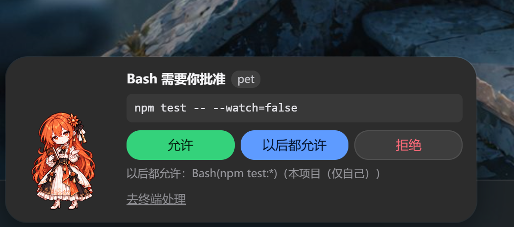
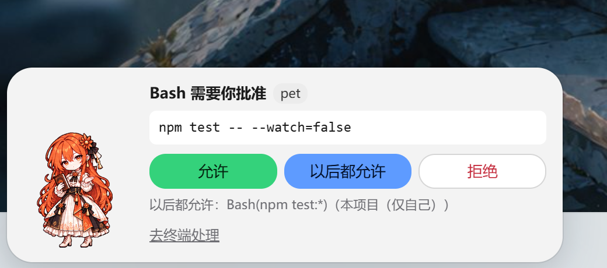
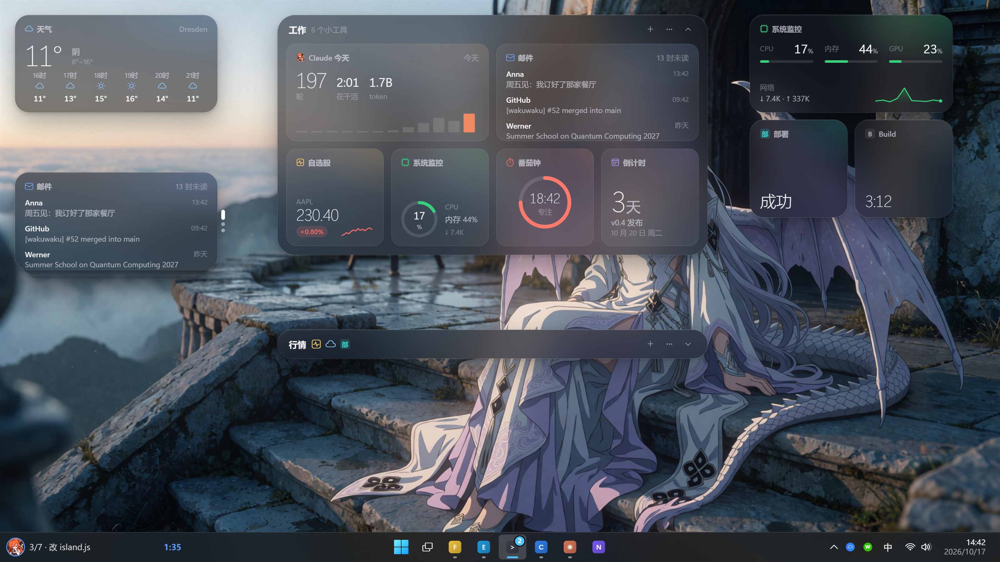
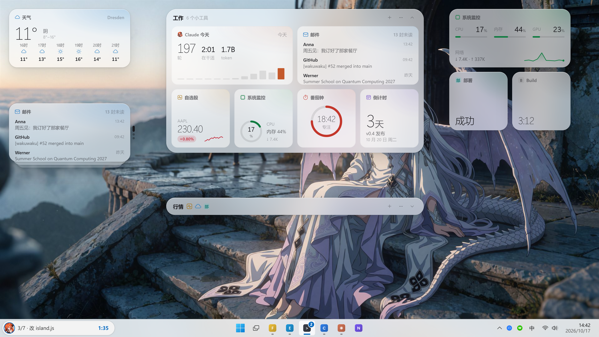

# 当前前端场景预览

2026-11-12 通过当前宿主源码与 `tools/preview` 场景重新渲染，Edge 无头浏览器，40 张场景截图均通过生成检查。这里保留批准面板与桌面布局的深浅主题示例；其余图留在忽略的 `.work/preview-shots/`。

```powershell
& ./tools/preview/render.ps1 -Out .work/preview-shots -Only 'scene-*' -NoOverview
```

截图来自真实 HTML/CSS/JS，Tauri 接口与账号、邮件数据为合成替身，不代表 Windows 原生窗口、真实账号、邮件或模型服务已联调通过。图片与背景素材不因文档入库而变为 MIT 代码资产；许可边界见[根许可](../../../LICENSE)与[来源说明](../../../assets/readme/SOURCES.md)。

## 批准面板





## 桌面布局





此前 `screenshots/` 的 JPG 属历史设计资料，不再作为当前版本实拍的证据。
